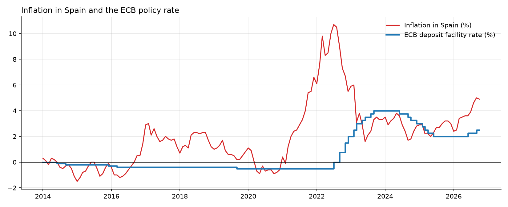
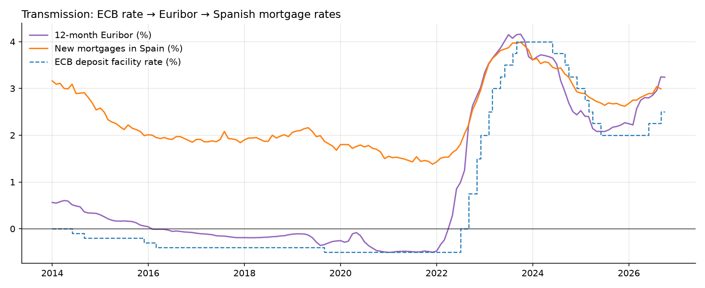
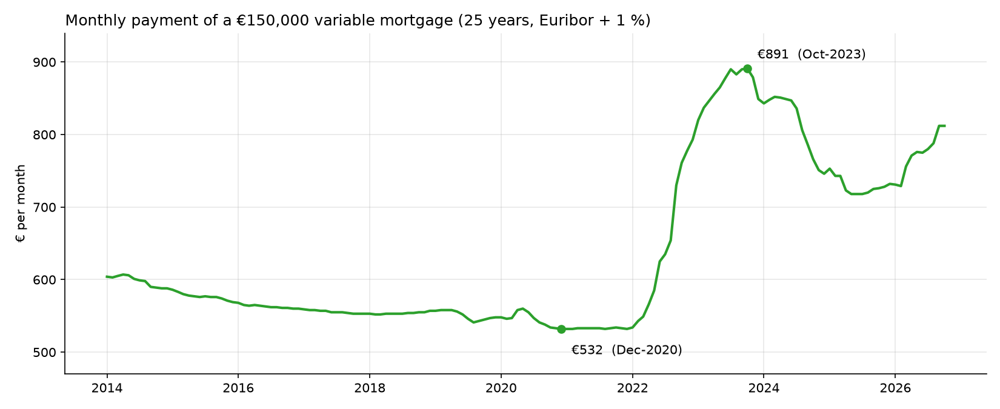

# Interest Rates and Spanish Households: an ECB Data Pipeline


---

# 🎓 About this Project

This project was developed as the final project of the **Data Collection Techniques** course in the **MSc in Big Data Science at the University of Navarra (Spain)**.

The brief was to collect data from an external source **without web scraping** and turn it into one clean, analysis-ready DataFrame. I chose the **European Central Bank's official API** and used it to answer a concrete question: *how much does an ECB monetary-policy decision change what a Spanish family pays for its mortgage?*

---

# 📌 Highlights

- ✅ Automated collection from the **official ECB Data Portal** (SDMX standard, no API key)
- ✅ 4 official series from 3 ECB dataflows (`FM`, `MIR`, `HICP`), 154 months (Jan-2014 → Oct-2026)
- ✅ Robust API client: automatic retries with back-off on temporary server errors (5xx)
- ✅ Frequency harmonisation: event-based policy rate → monthly series
- ✅ Business metric in euros: monthly payment of a €150,000 variable mortgage
- ✅ Fully reproducible: re-running the notebook downloads the latest data

---

# 📖 Project Overview

The pipeline follows the path of a monetary-policy decision down to households:

```
ECB policy rate  ──►  12-month Euribor  ──►  Spanish mortgage rates  ──►  monthly payment (€)
        ▲
   inflation (HICP)
```

1. **Discover** the right series in the ECB catalogue (dataflow → structure → key).
2. **Download** them through the SDMX API with the open-source package [`sdmx1`](https://github.com/khaeru/sdmx).
3. **Harmonise** them into one monthly DataFrame and run quality checks.
4. **Translate** percentages into euros with a derived mortgage-payment column.

---

# 🎯 Business Problem

Interest rates are usually reported as percentages, which say little to a household or a bank customer. Between 2022 and 2023 the ECB raised rates at the fastest pace in its history to fight inflation.

**Question:** how quickly, and by how much, did that decision reach Spanish mortgage holders?

Answering it requires reliable, up-to-date, official data from several statistical domains (financial markets, bank interest rates, prices), aligned on the same frequency.

---

# 📊 Data Source

| Attribute | Value |
|---|---|
| Provider | European Central Bank — [ECB Data Portal](https://data.ecb.europa.eu/) |
| Access | Public SDMX REST API (free, no account or key) |
| Python client | [`sdmx1`](https://github.com/khaeru/sdmx) (open source) |
| Period | January 2014 → last complete month |
| Frequency | Monthly |
| Output | [`data/ecb_spain_monthly.csv`](data/ecb_spain_monthly.csv) (154 rows × 5 columns) |

| Column | Dataflow | Series key | Meaning |
|---|---|---|---|
| `ecb_rate` | `FM` | `B.U2.EUR.4F.KR.DFR.LEV` | ECB deposit facility rate (policy rate) |
| `euribor_12m` | `FM` | `M.U2.EUR.RT.MM.EURIBOR1YD_.HSTA` | 12-month Euribor |
| `mortgage_rate_es` | `MIR` | `M.ES.B.A2C.AM.R.A.2250.EUR.N` | Rate on new house-purchase loans, Spain |
| `inflation_es` | `HICP` | `M.ES.N.000000.4D0.ANR` | Inflation in Spain (annual rate of change) |
| `payment_150k` | — | calculated | Monthly payment of a €150,000, 25-year mortgage at Euribor + 1 % |

More detail in [`data/README.md`](data/README.md) and [`docs/sdmx_series_keys.md`](docs/sdmx_series_keys.md).

---

# 🛠 Tech Stack

| Category | Technologies |
|---|---|
| Language | Python |
| Data collection | SDMX REST API, `sdmx1`, `requests` |
| Data processing | pandas (resampling, forward-fill, PeriodIndex) |
| Visualisation | Matplotlib |
| Environment | Jupyter Notebook |

---

# 🔬 Methodology

## 1. Data Discovery

The ECB publishes **105 dataflows**. The catalogue is listed through the API, and the structure of each relevant dataflow is read to learn which dimensions form a series key (e.g. `FREQ . REF_AREA . CURRENCY . ...`). Keys were then built and validated against the API.

## 2. Data Collection

A small client ([`src/ecb_client.py`](src/ecb_client.py)) extends `sdmx.Client` with **automatic retries** (10 s, 20 s, 30 s...) when the server answers with a temporary error such as `504 Gateway Time-out`. Each series is downloaded from 2008 and converted to a pandas Series indexed by date.

## 3. Frequency Harmonisation

Three series are monthly. The ECB policy rate only has a value on **decision days** (42 observations since 2008), so it is carried forward day by day and the value in force at each month end is kept.

## 4. Quality Checks

- 154 months, no duplicated periods
- Only one missing value: the latest month of the Spanish mortgage rate, because bank statistics are published 1–2 months later. It is **left missing, not imputed**.

## 5. Business Metric

The monthly payment of an example variable mortgage uses the standard (French) amortisation formula:

$$\text{payment} = \frac{P \cdot r}{1 - (1 + r)^{-n}}$$

with P = €150,000, n = 300 months and r = (Euribor 12m + 1 %) / 12, floored at 0 %.

---

# 📈 Results

| Month | 12m Euribor | Mortgage rate (Euribor + 1 %) | Monthly payment |
|---|---|---|---|
| Dec-2020 (minimum) | −0.50 % | 0.50 % | **€532** |
| Oct-2023 (maximum) | 4.16 % | 5.16 % | **€891** |

## Main Findings

- With inflation in Spain reaching **10.7 % (July 2022)**, the ECB raised its deposit rate from **−0.50 % to 4.00 % in 14 months** (Jul-2022 → Sep-2023).
- The **Euribor anticipated** the decisions: it started rising months before the first hike (July 2022).
- The rate on new Spanish mortgages followed the Euribor with a **lag of only a few months**.
- For the same €150,000 loan, the monthly payment rose by **about €360 (over €4,000 a year)**.

---

# 📂 Repository Structure

```
ecb-interest-rates-spain/
├── README.md
├── LICENSE
├── requirements.txt
├── notebooks/
│   └── ecb_interest_rates_spain.ipynb   # full pipeline, step by step
├── src/
│   └── ecb_client.py                    # API client with retries, download, monthly conversion
├── data/
│   ├── README.md                        # data dictionary
│   └── ecb_spain_monthly.csv            # final dataset
├── images/                              # figures generated by the notebook
└── docs/
    └── sdmx_series_keys.md              # how to find and read ECB series keys
```

### How to run

```bash
pip install -r requirements.txt
cd notebooks && jupyter notebook ecb_interest_rates_spain.ipynb
```

Or directly from Python:

```python
from src.ecb_client import build_dataset
df = build_dataset()      # downloads the latest data from the ECB
```

---

# 📷 Project Preview

### Inflation and the ECB Policy Rate

<p align="center">
  
</p>

*When inflation rose too fast in 2022, the ECB raised its rate to cool the economy down.*

### Transmission to Spanish Mortgages

<p align="center">
  
</p>

*The Euribor anticipates ECB decisions and Spanish mortgage rates follow it within a few months.*

### Monthly Payment of a €150,000 Mortgage

<p align="center">
  
</p>

*Same loan, same household: from €532 to €891 per month.*

---

# 💼 Potential Applications

- **Retail banking:** monitor how policy changes affect customers' mortgage payments and affordability.
- **Risk management:** feed official rate and inflation series into stress tests and credit-risk models.
- **Economic research & reporting:** automated, always up-to-date datasets for dashboards and briefings.
- **Real estate & fintech:** affordability calculators driven by live official data.

---

# 🔎 Methodological Considerations

- The mortgage payment is an **illustrative calculation** (fixed amount, term and spread), not an observed ECB statistic.
- `mortgage_rate_es` is the average rate on **new** loans; existing variable mortgages reprice on their own review dates.
- The previous ECB inflation series stopped in December 2025 and continues in the `HICP` dataflow; overlapping values were cross-checked.

### Problems found and how they were solved

| Problem | Solution |
|---|---|
| `pd.read_csv(url)` on the API failed with an SSL certificate error on macOS | Use `sdmx1`, which handles the secure connection |
| `400` / `404` errors from wrong keys or frequencies that do not exist | Read each dataflow's structure first and check the available frequencies |
| The policy rate only changes on decision days | Forward-fill daily and keep the month-end value |
| The inflation series stopped in December 2025 | Located its new dataflow (`HICP`) in the catalogue and verified both matched |
| Occasional `504 Gateway Time-out` from the ECB server | Client with automatic retries and increasing waits |

---

# 🔮 Future Improvements

- [ ] Add the **Swiss National Bank** data portal (SNB policy rate, SARON, CHF/EUR) and compare ECB vs SNB transmission
- [ ] Extend to other euro-area countries (only the `REF_AREA` code of the `MIR` key changes)
- [ ] Monthly automatic refresh with GitHub Actions
- [ ] Estimate the pass-through lag from Euribor to mortgage rates with a time-series model

---

# 👤 Author

**Juan Jesús Gómez Ortiz**
Mechanical Engineer | MSc in Big Data Science

[LinkedIn](https://www.linkedin.com/in/jj-gomez-ortiz/) · [GitHub](https://github.com/jj-gomez-ortiz)

---

# 📄 License

This project is licensed under the MIT License — see [LICENSE](LICENSE). ECB data is subject to the [ECB's terms of use](https://www.ecb.europa.eu/services/disclaimer/html/index.en.html).
